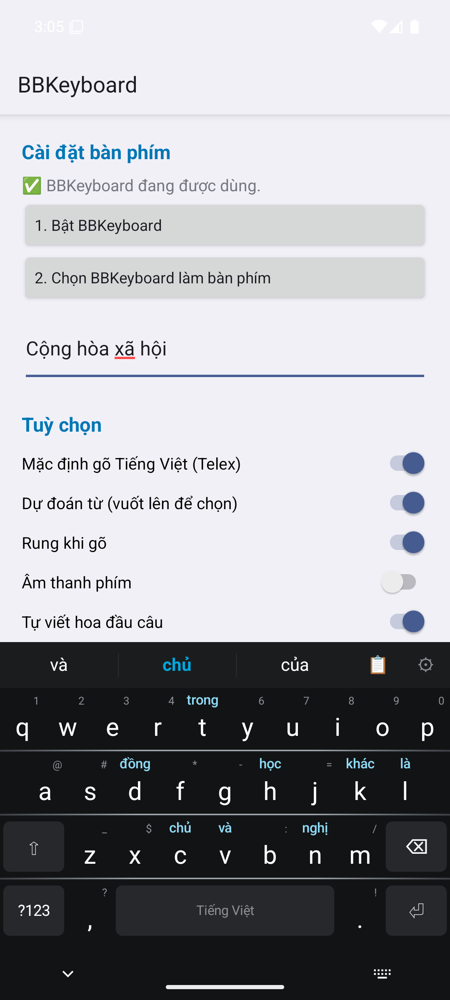
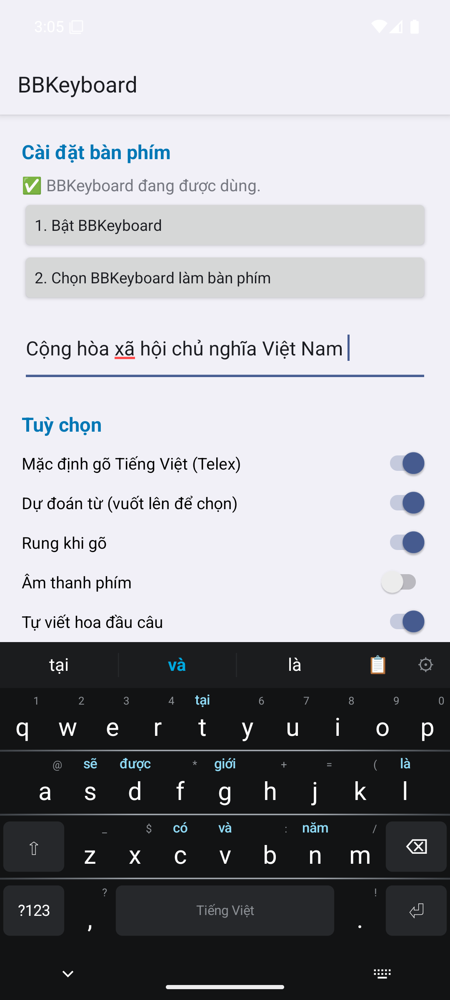
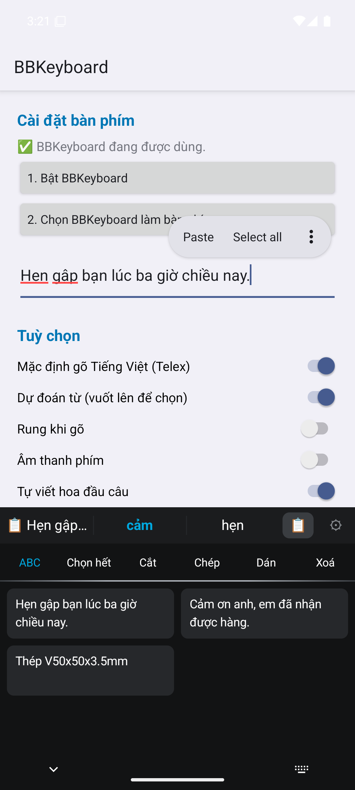
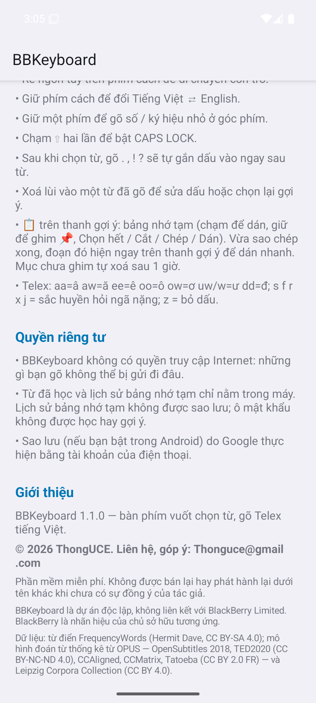

# BBKeyboard

**Bàn phím Android vuốt chọn từ phong cách BB, gõ Telex tiếng Việt, đoán từ theo ngữ cảnh — miễn phí, không quảng cáo, không cần Internet.**

### [⬇️ Tải bản mới nhất](../../releases/latest)

Android 8.0 trở lên · chỉ xin quyền **Rung** · © 2026 ThongUCE

<p>
  
  
  
  
</p>

## Tính năng

- **Vuốt lên để chọn từ:** gợi ý hiện ngay trên phím của chữ cái tiếp theo; vuốt lên từ phím đó để chèn cả từ kèm dấu cách.
- **Đoán từ theo 1–3 từ trước:** "Cộng hòa xã hội" → *chủ*, "giá vàng" → *hôm nay*, "kiểm" → *tra*. Mô hình dựng từ khoảng 20 triệu câu tiếng Việt (phụ đề, tin tức, web).
- **Học thói quen gõ của bạn:** từ và cụm từ hay dùng tự lên đầu gợi ý.
- **Tự viết hoa tên riêng:** "viet nam", "ha noi" → *Việt Nam*, *Hà Nội* (tắt được).
- **Telex đầy đủ, gõ dấu tự do:** `vietej`, `duongwf` đều ra đúng; từ tiếng Anh gõ ở chế độ Việt vẫn giữ nguyên.
- **Bảng nhớ tạm kiểu Gboard:** lịch sử 30 mục, ghim, Chọn hết / Cắt / Chép / Dán, gợi ý dán nhanh đoạn vừa sao chép.
- **Cử chỉ:** vuốt trái xoá từ, vuốt xuống mở số và ký hiệu, rê phím cách để di chuyển con trỏ, giữ phím cách đổi Việt ⇄ Anh, giữ phím để gõ số và ký hiệu.
- Giao diện tối BB10 với đường kim loại giữa các hàng phím; có giao diện sáng và 3 mức chiều cao.

## Quyền riêng tư

- App **chỉ xin quyền Rung**. Không có quyền Internet, nên những gì bạn gõ không thể bị gửi ra ngoài. Bạn có thể tự kiểm tra trong *Cài đặt → Ứng dụng → BBKeyboard → Quyền*.
- Từ đã học chỉ nằm trong máy. Ô mật khẩu không được học hay gợi ý.
- Lịch sử bảng nhớ tạm không được sao lưu; mục chưa ghim tự xoá sau 1 giờ.
- Đổi máy: dùng *Sao lưu ra tệp / Khôi phục từ tệp* trong app, hoặc sao lưu Google của Android.

## Cài đặt

1. Tải file `BBKeyboard-vX.Y.Z.apk` ở trang [Releases](../../releases/latest) và mở để cài. Cho phép cài từ nguồn này nếu máy hỏi; nếu Play Protect cảnh báo (vì app không đến từ Play Store), chọn *Vẫn cài đặt*.
2. Mở app **BBKeyboard** → **1. Bật BBKeyboard** → gạt bật.
3. **2. Chọn BBKeyboard làm bàn phím**, rồi gõ thử trong ô *Gõ thử ở đây…*.
4. Nếu thanh điều hướng che hàng phím dưới: *Khoảng trống dưới bàn phím → Thêm*.

## Kiểm tra file tải về

Mỗi bản phát hành có mã **SHA-256** trong ghi chú phát hành và file `SHA256SUMS.txt`. Tất cả các bản đều được ký bằng cùng một chữ ký:

```
CN=ThongUCE, OU=BBKeyboard, C=VN
SHA-256: 967d0762a5f44f0425b6a278175e51e0cb3883f069b863ad734c14182834923d
```

Nếu Android báo chữ ký khác khi cập nhật, đó không phải bản chính thức.

## Bản quyền

© 2026 **ThongUCE** — Thonguce@gmail.com. Phần mềm miễn phí, xem [LICENSE.txt](LICENSE.txt). Dữ liệu ngôn ngữ có giấy phép riêng, xem [THIRD_PARTY_NOTICES.md](THIRD_PARTY_NOTICES.md).

BBKeyboard là dự án cá nhân độc lập, không liên kết với BlackBerry Limited.

Góp ý và báo lỗi: mở mục [Issues](../../issues) (kèm ảnh chụp màn hình và dòng máy) hoặc gửi về Thonguce@gmail.com.
